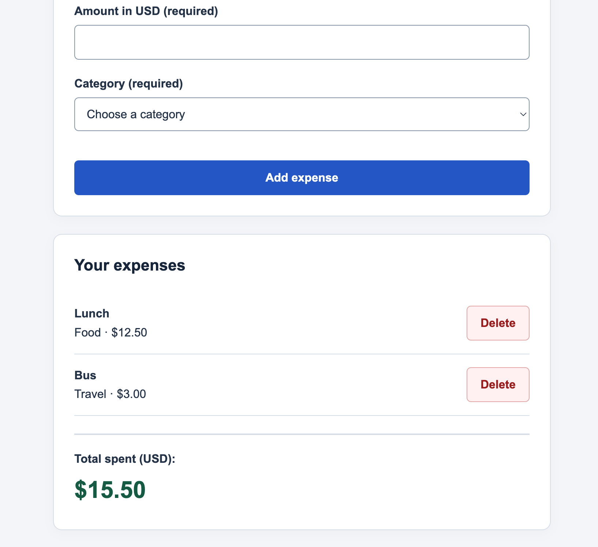
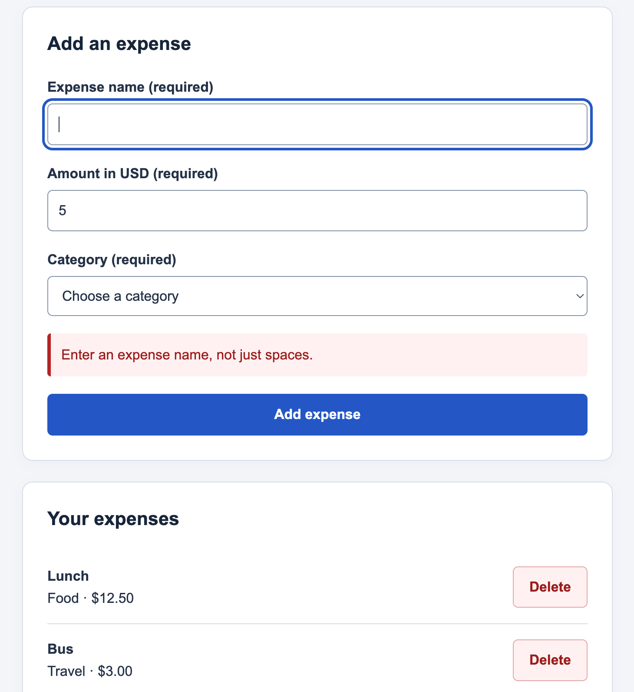
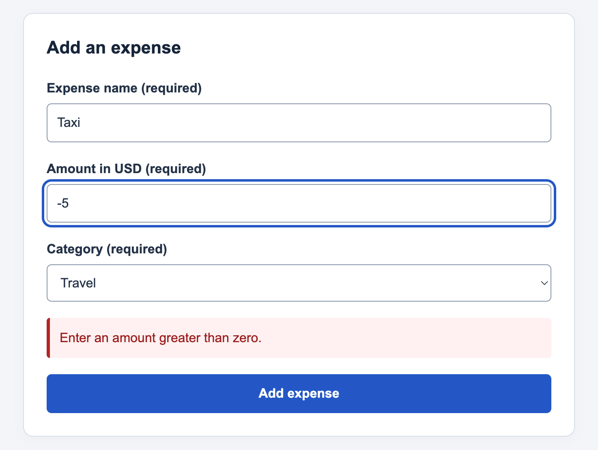
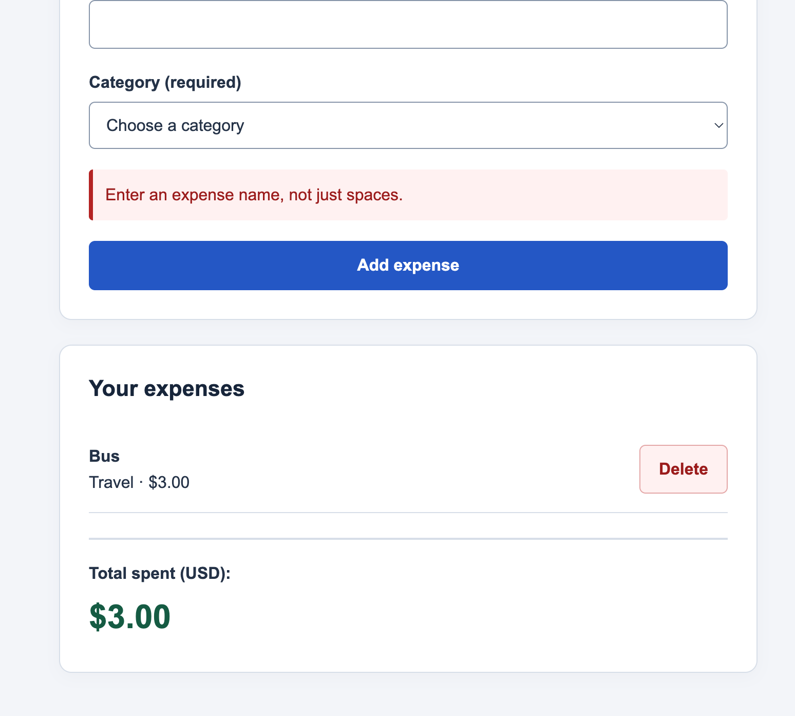

# Smart Expense Tracker

A beginner-friendly expense tracker built with HTML, CSS, and plain JavaScript. No dependencies, backend, database, or login are required.

## Run

Open `index.html` in a browser. No installation or build step is needed.

**Expenses are stored in memory and reset when you refresh the page.**

## Features

- Add expenses with a trimmed name, amount, and category; delete individual entries.
- Display each expense and an automatically updated USD total with two decimal places.
- Store amounts as integer cents to avoid decimal addition errors.
- Reject blank names, missing or nonnumeric amounts, zero or negative amounts, more than two decimal places, invalid categories, and amounts or totals outside the safe numeric range.
- Show specific validation messages without changing existing expenses or totals.
- Reset the form and clear errors after successful additions; show an empty-state message when no expenses remain.
- Render names as plain text, with responsive styling, labeled fields, and visible keyboard focus.

## Development and Testing

- [Initial prompt](prompts/initial_prompt.md)
- [Follow-up prompts](prompts/followup_prompts.md)
- [Test results](test_results.md)
- [Amount-validation improvement](improvement_note.md)

The test record documents passing manual checks for adding and deleting expenses, invalid inputs preserving totals, refresh behavior, Tab navigation, and Enter submission. It separately records 22 agent-reported automated browser checks at 1280px and 375px and a JavaScript syntax check. Screen-reader announcements and other browsers remain unverified.

## Screenshots

### Entered expenses

### Invalid input

### Improved amount validation

### After deletion

